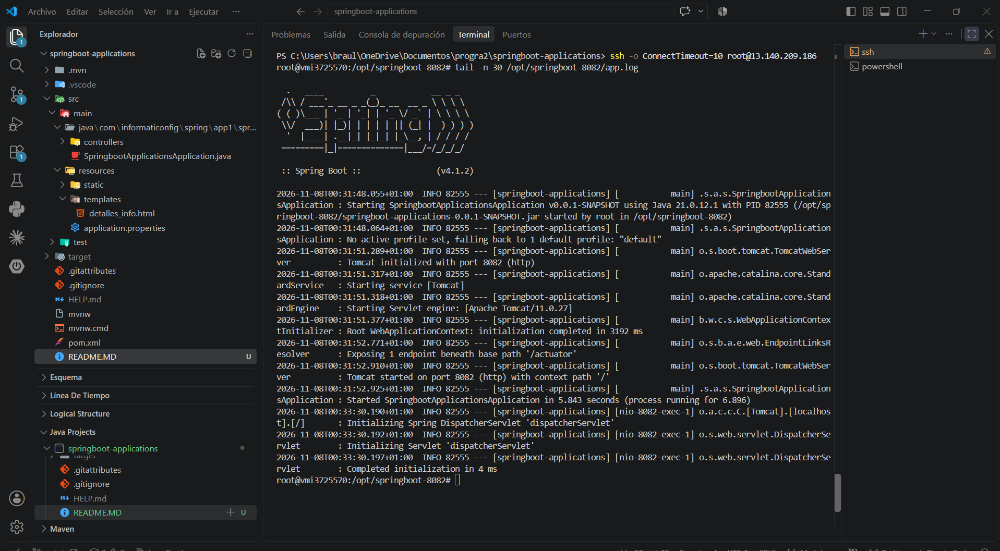
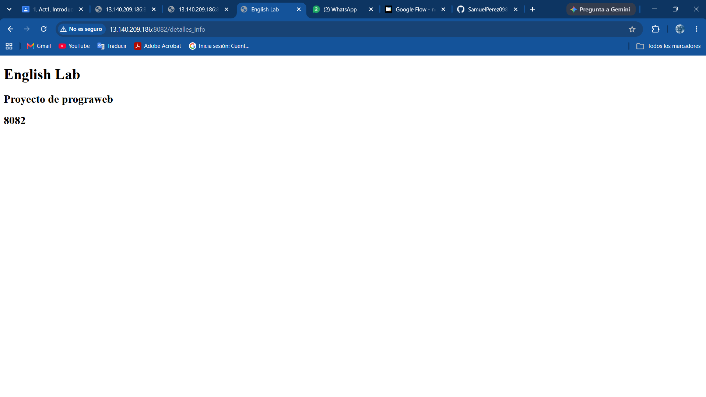
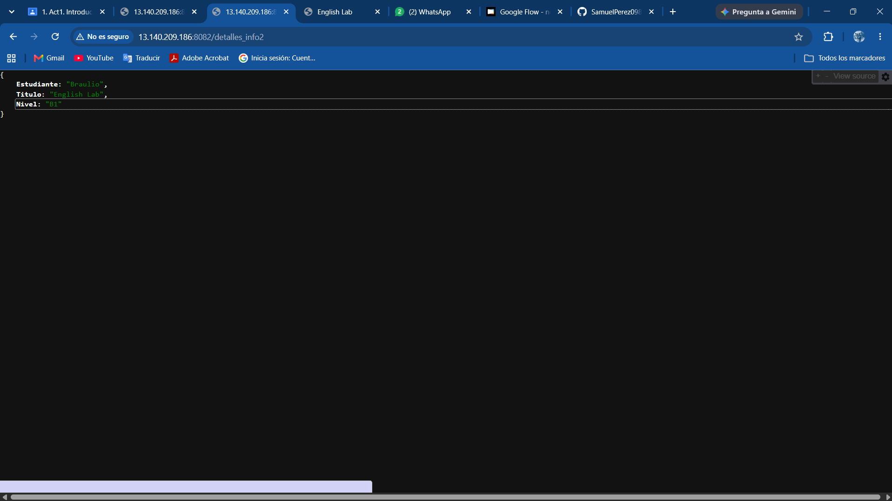
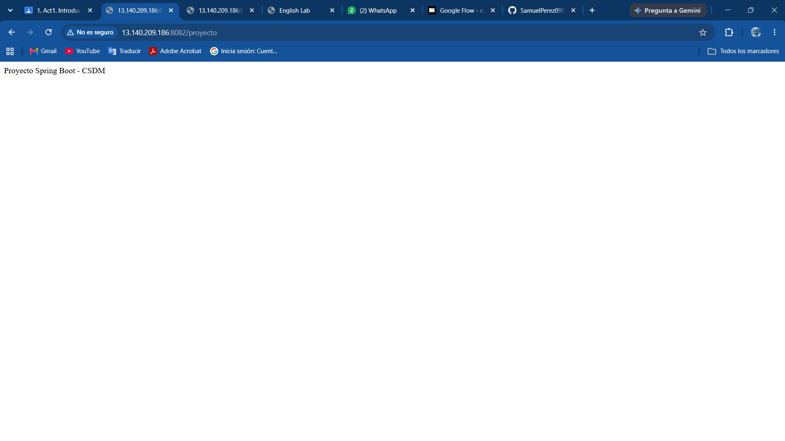

# Actividad 1: Introducción a Spring Boot

## 1. Descripción del proyecto

En este proyecto el objetivo es aprender a configurar un entorno de desarrollo con Java y Spring Boot, crear controladores que respondan a peticiones HTTP y comprobar el funcionamiento de una aplicación web.

## 2. Tecnologías, estructura y controladores

### Tecnologías utilizadas

- **Java 21:** Lenguaje de programación utilizado.
- **Spring Boot 4.1.2:** Framework para desarrollar la aplicación web.
- **Maven:** Gestión de dependencias y compilación del proyecto.
- **Spring Web:** Creación de controladores y endpoints HTTP.
- **Thymeleaf:** Generación de páginas HTML dinámicas.
- **Visual Studio Code:** Entorno de desarrollo.

### Estructura del proyecto

```text
springboot-applications/
├── src/
│   ├──img
│   └── main/
│       ├── java/
│       │   └── com/informaticonfig/spring/app1/
│       │       └── springboot_applications/
│       │           ├── controllers/
│       │           │   ├── EjemploController.java
│       │           │   └── EjemploRestController.java
│       │           └── SpringbootApplicationsApplication.java
│       └── resources/
│           ├── templates/
│           │   └── detalles_info.html
│           └── application.properties
├── pom.xml
├── mvnw
└── mvnw.cmd
```

### Controladores y endpoints

Se implementaron dos controladores utilizando las anotaciones `@Controller` y `@RestController`.

**EjemploController.java**

Utiliza `@Controller` para manejar peticiones web y mostrar una página HTML mediante Thymeleaf.

- `GET /detalles_info`: Muestra una página con información del proyecto English Lab.

**EjemploRestController.java**

Utiliza `@RestController` para devolver respuestas directamente al cliente en formato JSON o texto.

- `GET /detalles_info2`: Devuelve un objeto JSON con información simulada de un estudiante, como su nombre y nivel de inglés.
- `GET /proyecto`: Devuelve un texto que identifica el proyecto Spring Boot.

| Método | Endpoint | Tipo de respuesta |
|---|---|---|
| GET | `/detalles_info` | HTML |
| GET | `/detalles_info2` | JSON |
| GET | `/proyecto` | Texto |

## 3. Configuración del puerto 8082

Spring Boot utiliza el puerto `8080` de manera predeterminada. Para esta actividad se configuró el puerto `8082`, con el objetivo de evitar conflictos con las aplicaciones de otros integrantes del equipo.

La configuración se realizó en el archivo `src/main/resources/application.properties`:

```properties
server.port=8082
spring.application.name=springboot-applications
```

Con esta configuración, los endpoints pueden consultarse localmente mediante:

- `http://13.140.209.186:8082/detalles_info`
- `http://13.140.209.186:8082/detalles_info2`
- `http://13.140.209.186:8082/proyecto`

## 4. Capturas

### Ejecución en el puerto 8082



### Endpoint /detalles_info



### Endpoint /detalles_info2



### Endpoint /proyecto



