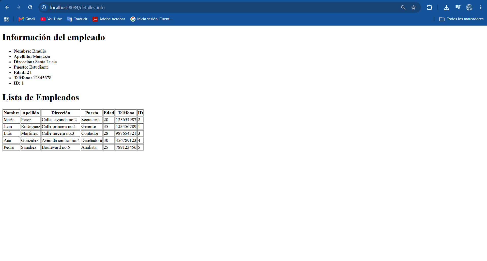
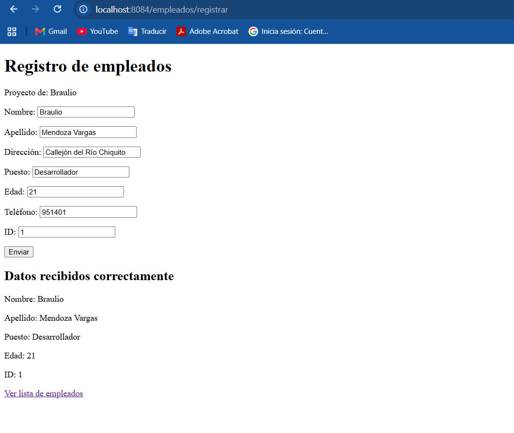
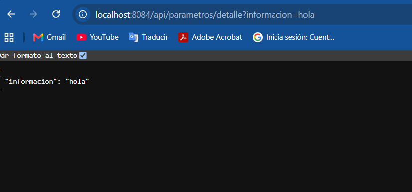
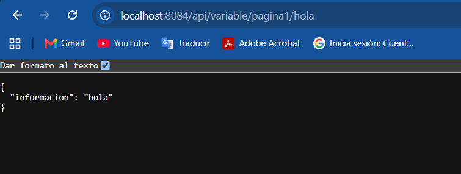
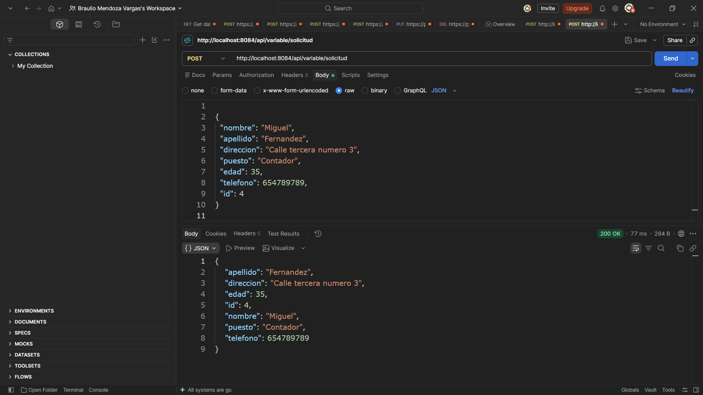

# Actividad 2: Spring Boot MVC y Thymeleaf

## 1. Descripción

Aplicación basada en una copia independiente de la Actividad 1. Se utilizan Spring Boot, Thymeleaf, Model y DTO para mostrar una lista de empleados, recibir datos desde un formulario y responder peticiones HTTP.

## 2. Tecnologías y funcionalidades

Java 21, Spring Boot 4.1.2, Maven, Spring Web MVC, Thymeleaf y Postman.

- `EjemploController`: vista `/detalles_info` con la lista de empleados (`Model` y `th:each`).
- `FormularioController`: vista `/empleados/formulario` y recepción de datos por `@ModelAttribute` en `POST /empleados/registrar`.
- `EmpleadoDTO`: objeto utilizado tanto en el formulario HTML como en el endpoint REST POST.
- `RquestParamControllers`: endpoint GET con `@RequestParam`.
- `PathVariableController`: endpoint GET con `@PathVariable`, POST con `@RequestBody` y propiedades con `@Value`.
- `@Value` obtiene `config.usuario` desde `application.properties` y lo muestra en el formulario.

## 3. Endpoints

| Método | Ruta | Función |
|---|---|---|
| GET | `/detalles_info` | Tabla de empleados con Thymeleaf |
| GET | `/empleados/formulario` | Formulario enlazado a EmpleadoDTO |
| POST | `/empleados/registrar` | Recepción del formulario con ModelAttribute |
| GET | `/api/parametros/detalle?informacion=hola` | RequestParam |
| GET | `/api/variable/pagina1/hola` | PathVariable |
| GET | `/api/variable/valores` | Propiedades mediante Value |
| POST | `/api/variable/solicitud` | Petición JSON mediante RequestBody y EmpleadoDTO |

## 4. Configuración local

En `src/main/resources/application.properties` se configuró `server.port=8084` para no interferir con la Actividad 1 (8082).

## 5. Capturas de evidencia

vista `/detalles_info` con `th:each`.
 
formulario después de enviar datos con `@ModelAttribute` y `@Value` visible.
 
petición GET con `@RequestParam`.
 
petición GET con `@PathVariable`.
 
 POST en Postman y respuesta JSON correcta.
 

## 6. Publicación

Repositorio: https://github.com/mendozavargasbraulio/BMVact2_t4

Actividad 2 (puerto 8084): `hola` 

Actividad 1 (puerto 8082): `http://13.140.209.186:8082/proyecto` 
